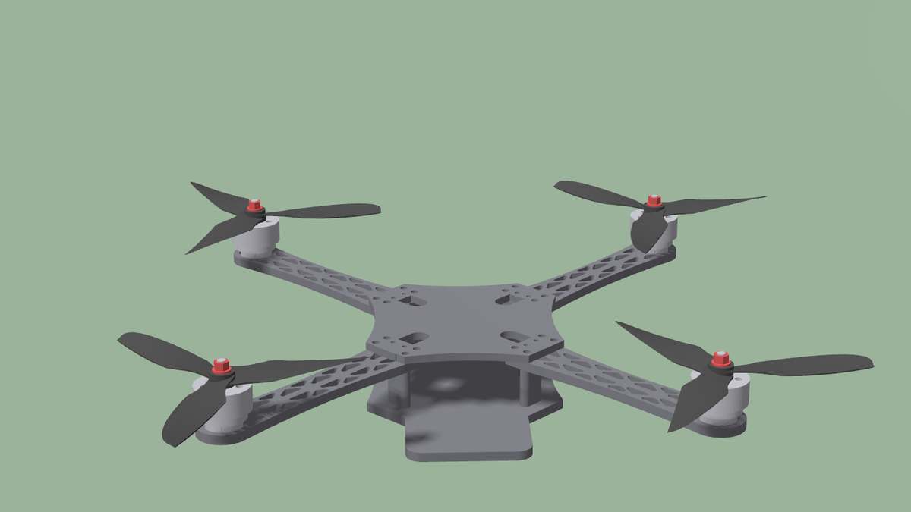
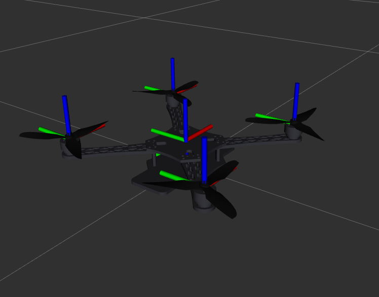
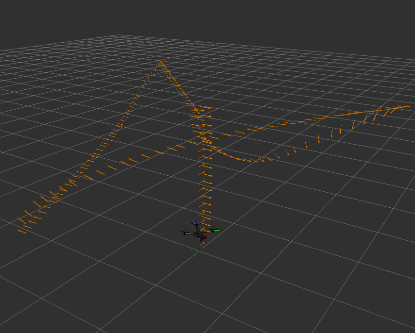

# my_drone



Quadcopter simulation for ROS 2 Jazzy + Gazebo Harmonic: **Custom Drone
Build 03**, a 7-inch true-X quad (404 mm, 0.931 kg all-up) built from CAD,
with 2807SL motors and 7040 tri-blade props on 6S.

It flies on its own cascaded flight controller (position, velocity,
attitude, rate, mixer), the same structure PX4 and ArduPilot use, with
keyboard teleop and go-to-goal waypoints. How it works, with plots from the
sim: **[docs/controller.pdf](docs/controller.pdf)**.

| RViz: body and rotor frames | RViz: odometry trail of a waypoint route |
|---|---|
|  |  |

Gazebo's built-in velocity controller is still available with
`controller:=gz`, for comparison.

Props spin in the standard props-in pattern, seen from above:
front-left CW, front-right CCW, rear-left CCW, rear-right CW.

## Build

```bash
cd ~/ros2_ws && source /opt/ros/jazzy/setup.bash && colcon build --packages-up-to my_drone_bringup my_drone_teleop
```

## Run

Every new terminal:

```bash
source /opt/ros/jazzy/setup.bash && source ~/ros2_ws/install/setup.bash
```

Launch (opens Gazebo and RViz):

```bash
ros2 launch my_drone_bringup sim.launch.py
```

Options: `rviz:=false`, `headless:=true` (no Gazebo window), `z:=0.5`
(spawn height), `controller:=gz` (Gazebo's built-in velocity controller
instead of ours; no `/goal_pose` then).

Fly, in a second terminal (needs a real keyboard/TTY):

```bash
ros2 run my_drone_teleop arrow_teleop
```

| Key | Action |
|---|---|
| `w` / `s` | climb / descend (`w` to take off) |
| arrows | forward / back / strafe |
| `a` / `d` | yaw left / right |
| `space` | stop and hover |
| `+` / `-` | speed scale |
| `q` / Ctrl+C | land, stop the motors, quit (Ctrl+C twice: stop motors now) |

The drone spawns disarmed with its props still. Teleop arms it when it
starts (props spin up to idle-hover speed); quitting teleop sends `/land`,
and the controller descends and disarms on touchdown, so the props stop.
Your terminal is restored either way.

Land or kill from anywhere:

```bash
ros2 topic pub --once /land std_msgs/msg/Empty
```
```bash
ros2 topic pub --once /enable std_msgs/msg/Bool "{data: false}"
```

The first lands and disarms; the second stops the motors at once, in the
air too.

Stop the sim with Ctrl+C in the launch terminal or by closing the Gazebo
window: either stops everything. Any process a crashed session left behind
is cleared at the next launch.

Go to goal, in a second terminal: each waypoint is `x,y,z[,yaw_deg]` in
the odom frame. The script arms the drone, flies the waypoints in order and
prints the time and overshoot for each, then leaves it hovering. Ctrl+C
(or a waypoint that times out) lands it instead; Ctrl+C again kills the
motors. Waypoints need 0 < z <= 30 m.

```bash
ros2 run my_drone_teleop goto 0,0,2 3,3,2 -2,1,1,90 0,0,0.3
```

RViz's *2D Goal Pose* tool works too (it keeps the current altitude, or
takes off to 1.5 m).

### RViz

Side panels start hidden; click the arrow on the left/right window edge to
open Displays / Views. Left-drag orbits, middle-drag pans, wheel zooms.
Saved views: *Follow drone* (default), *World (fixed)*, *Top down*.

## Topics

| Topic | Type | Direction |
|---|---|---|
| `/cmd_vel` | `geometry_msgs/Twist` (heading-frame velocity + yaw rate) | in |
| `/goal_pose` | `geometry_msgs/PoseStamped` (position + yaw, odom frame) | in |
| `/enable` | `std_msgs/Bool` (arm / disarm; false = motor kill) | in |
| `/land` | `std_msgs/Empty` (descend, disarm on touchdown) | in |
| `/armed` | `std_msgs/Bool` (latched, on change) | out |
| `/motor_speed` | `actuator_msgs/Actuators` (rotor speeds, rad/s) | controller → gz |
| `/odom` | `nav_msgs/Odometry` (state_estimator's estimate, 50 Hz) | out |
| `/ground_truth/odom` | `nav_msgs/Odometry` (gz's exact state, for scoring only) | out |
| `/imu` | `sensor_msgs/Imu` (250 Hz; no orientation) | out |
| `/air_pressure` | `sensor_msgs/FluidPressure` (50 Hz) | out |
| `/magnetic_field` | `sensor_msgs/MagneticField` (100 Hz, gauss: a gz Harmonic quirk) | out |
| `/navsat` | `sensor_msgs/NavSatFix` (10 Hz) | out |
| `/joint_states` | `sensor_msgs/JointState` (prop angles) | out |
| `/tf`, `/clock` | | out |

## State estimator

The controller flies on what the sensors say, not on Gazebo's exact state.
`my_drone_control/src/state_estimator.cpp` (ROS I/O, start-up) around
`my_drone_control/include/my_drone_control/estimator.hpp` (the filter, no
ROS) is a 15-state error-state EKF in the shape of PX4's EKF2: the IMU
predicts position, velocity and attitude (and its own biases), GNSS
position, barometer height and the magnetometer's direction correct them.

Sensor noise is PX4's x500: Gaussian IMU, barometer (3 Pa) and
magnetometer noise, and GNSS at the ~2 cm PX4 adds to the x500's fix. The
filter starts once the drone has sat still for 1 s; that spot (`origin` in
`controller.yaml`) is the odom origin, so `/odom` minus `/ground_truth/odom`
is the estimation error. On a hover / move / 90 deg yaw route it is ~2 cm
horizontal and ~4 cm vertical RMS, ~0.25 deg in attitude.

## Flight controller

`my_drone_control/src/flight_controller.cpp` (ROS I/O, modes, failsafes)
around `my_drone_control/include/my_drone_control/control.hpp` (the math,
no ROS). It is the cascade PX4 and ArduPilot
use, in physical units:

```
/goal_pose ─▶ position P ─▶ velocity PID ─▶ thrust vector ─▶ attitude P ─▶ rate PID ─▶ mixer ─▶ /motor_speed
/cmd_vel   ───────────────────▲            (tilt limit)    (quaternion)              (from rotor geometry)
```

- Each `/imu` sample (250 Hz) runs the loop, like a real FC's gyro. `/odom`
  (50 Hz) is the state estimate; attitude is propagated with the gyro in
  between.
- Modes: the last input wins. `/goal_pose` gives position mode, `/cmd_vel`
  gives velocity mode. Centre the stick (or stop sending) and it brakes, then
  holds position.
- On the ground it idles until something asks to climb. If `/odom` stops it
  levels out and sinks slowly. Disarm stops the motors at once.
- Touchdown (asked down, not moving, thrust under hover, below
  `land_slow_alt`) disarms in every mode, so landing does not depend on the
  client staying alive. Goals below 0 or above `alt_max` are rejected.
- Mass, inertia, motor constants and rotor layout come from the
  `<quad_physics>` element `quad_gazebo.xacro` writes into the URDF, so they
  always match the Gazebo model. Gains are in `my_drone_control/config/controller.yaml`
  (physical units, so they do not need rescaling when the mass changes).
  Tune inner to outer: rate, attitude, velocity, position.

`colcon test --packages-select my_drone_control` runs the sign and scale
checks in `my_drone_control/test/test_control.cpp`. Scalar limits
(`tilt_max_deg`, timeouts, ...) are range-checked by the parameter server,
so a bad value fails at start-up.

## Layout

Four packages, split by what they depend on: the controller builds and
tests without Gazebo, and the description can be reused on hardware.

```
my_drone_description/   the model, no runtime deps beyond xacro
  urdf/quad_mesh_common.xacro  motor/prop physics + spinning prop macros
  urdf/quad_gazebo.xacro       gz plugins: motor models, sensors, exact odom; <quad_physics>
                               for our controller; gz velocity controller if controller:=gz
  urdf/build03_params.xacro    mass, inertia, rotor positions (gz controller gains)
  urdf/build03.urdf.xacro      frame meshes + collision boxes
  meshes/                      STLs (mm) copied from the CAD folders
my_drone_control/       flight controller and state estimator (C++)
  include/my_drone_control/control.hpp   the cascade maths, ROS-free, header-only
  include/my_drone_control/estimator.hpp the EKF, ROS-free, header-only
  src/flight_controller.cpp              node: topics, modes, failsafes
  src/state_estimator.cpp                node: sensors -> /odom
  config/controller.yaml                 gains, limits, estimator noise
  test/test_control.cpp                  gtest sign/scale checks
  test/test_estimator.cpp                gtest EKF convergence checks
my_drone_teleop/        operator tools (Python): arrow_teleop, goto
my_drone_bringup/       simulation: launch/sim.launch.py, worlds/,
                        config/bridge_build03.yaml (ROS <-> gz), rviz/
tools/mass_budget.py    mass / CoM / inertia from meshes + part weights (not installed)
docs/                   controller write-up (controller.html|pdf; build_pdf.py prints
                        it with Firefox, make_figures.py plots data/flight.npz), images
```

## When real weights are known

Masses are estimates: printed frames by mesh volume (PAHT-CF, 1.06 g/cm³),
motors, props and battery from datasheets, and electronics guessed. After
weighing:

1. Edit the tables at the top of `tools/mass_budget.py` (it reads the CAD
   folders under `/media/safwan/Shared/Drone_Frames`, or `$DRONE_FRAMES`).
2. Run `python3 tools/mass_budget.py` and paste the printed values into
   `my_drone_description/urdf/build03_params.xacro`.
3. Our controller picks the new values up by itself. Only for
   `controller:=gz`: rescale `attitude_gain` / `angular_rate_gain` by the
   inertia change per axis and `velocity_gain` by the mass change. Gazebo's
   controller normalises gains by both, so this keeps the same response.

## History

The original F450 model was removed in 0.2.0 (`git checkout f450-final`
restores it). The WEAREFPV JeNo 7 was removed in 0.3.0 (`git checkout
v0.2.1` has it). 0.4.0 split the single `my_drone` package into the four
above; `git checkout v0.3.0` has the old layout.
